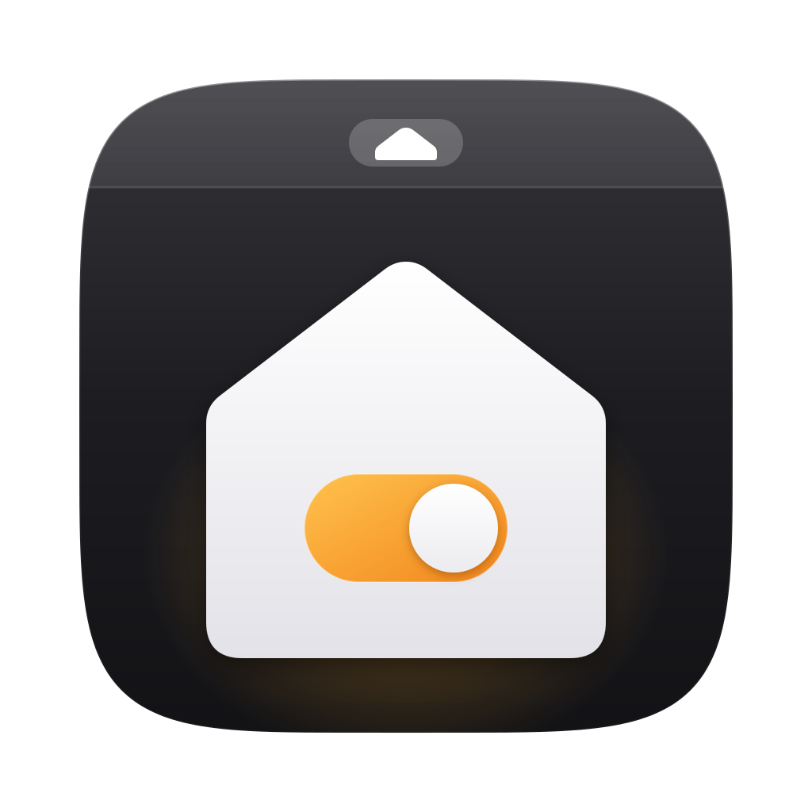
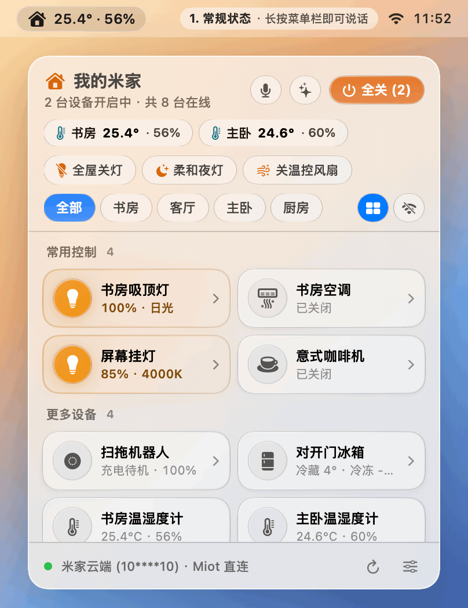
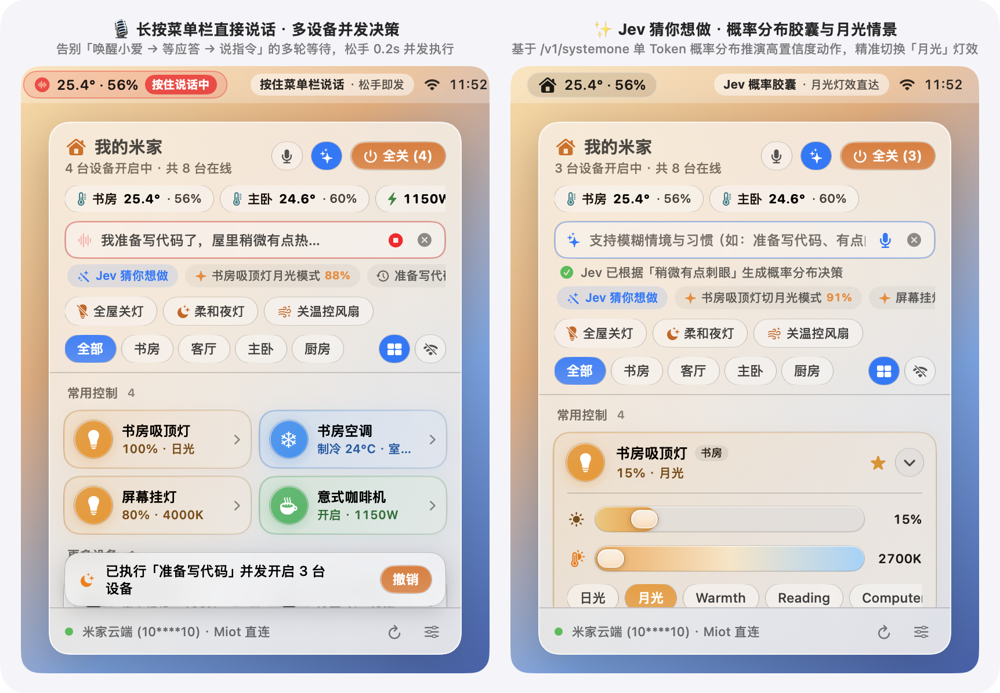
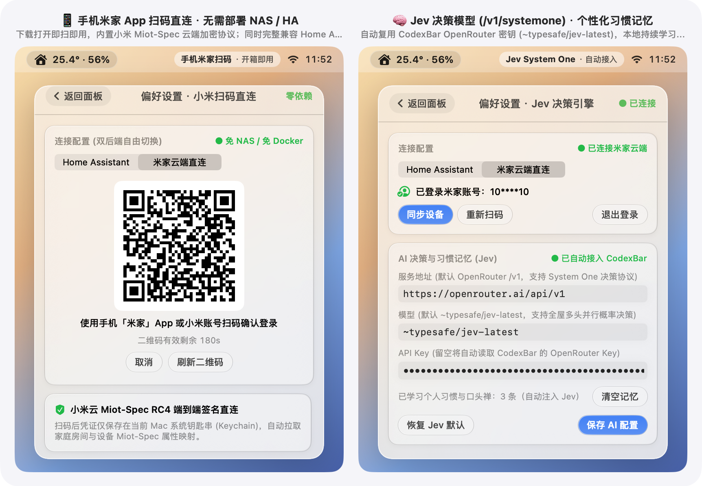

<p align="center">
  
</p>

<h1 align="center">MenuBarMijia</h1>

<p align="center">
  <b>Native macOS menu-bar & Windows 11 tray controller for Xiaomi Mi Home (Mijia) and Home Assistant.</b><br>
  Hold the menu-bar icon, speak a command, release to execute across multiple devices in ~0.2s — or run the entire panel from the keyboard.
</p>

<p align="center">
  <strong>English</strong> · <a href="README.zh-CN.md">简体中文</a>
</p>

<p align="center">
  <a href="https://github.com/jryang1997/MenuBarMijia/releases/latest"></a>
  
  
  
  
  <a href="LICENSE"></a>
</p>

<p align="center">
  
</p>

<p align="center">
  
</p>

<p align="center">
  
</p>

<p align="center">
  
</p>

This project is a personal open-source app (`MenuBarMijia.app` on macOS, plus a companion Windows 11 Tauri v2 tray app in `windows/` and Synology NAS Home Assistant scripts in `nas/`). It is not affiliated with, authorized by, or endorsed by Xiaomi, Mi Home, or Midea. “Xiaomi”, “Mi Home” (米家), and “Midea” are trademarks of their owners and are used here only to name compatible products.

## Requirements

- macOS 14 (Sonoma) or later (`Package.swift` sets `.macOS(.v14)`; macOS 26 renders native SwiftUI `.glassEffect` Liquid Glass, while macOS 14 and 15 fall back to `.ultraThinMaterial`; `MijiaCore` also builds on Linux with Swift 6.1)
- Swift 6 toolchain to build

The Swift package has no third-party Swift dependencies and uses Swift 6 strict concurrency.

## Install

### GitHub Releases

Releases: <https://github.com/jryang1997/MenuBarMijia/releases>

**v1.0.2** is the latest. It includes `MenuBarMijia-1.0.2.dmg` for macOS (with full English & Simplified Chinese UI and voice commands) and Windows installers.

The macOS app is ad-hoc signed and not notarized. On first launch, open **System Settings → Privacy & Security** and choose **Open Anyway**, or run:

```bash
xattr -cr /Applications/MenuBarMijia.app
```

**v1.0.0** macOS assets were named `MenuMijia-1.0.0.dmg`.

After install, enable **Launch at login** in Settings if you want the menu-bar icon at startup. **Check for updates** in Settings reads GitHub Releases.

### Build from source

```bash
git clone https://github.com/jryang1997/MenuBarMijia.git
cd MenuBarMijia
bash scripts/build_app.sh
```

The script builds a Release binary, writes microphone and speech-recognition usage strings into `MenuBarMijia.app`, signs it locally, and launches it. Drag `MenuBarMijia.app` to `/Applications` if you want it there.

A Developer ID build, DMG, and Apple notarization are optional and need an Apple Developer account:

```bash
DEVELOPER_ID="Developer ID Application: Your Name (TEAMID)" \
bash scripts/release.sh
```

Store notary credentials first with `xcrun notarytool store-credentials menumijia-notary`. `SKIP_NOTARIZE=1` packs a local DMG without notarization. The version string is the `VERSION` file. The build number is the git commit count.

## Connect devices

Open the menu-bar icon, then the settings button.

**Mi Cloud (no Home Assistant).** Choose **Mi Cloud direct**, then **Scan to sign in to Mi Home**, and confirm the QR code in the phone Mi Home app. Homes, rooms, and devices sync from your account. The client speaks Miot-Spec over Xiaomi’s RC4-signed `api.io.mi.com` API. `serviceToken` and `ssecurity` stay in the macOS Keychain. Note: `api.io.mi.com` is an undocumented private client API, and Xiaomi has restricted accounts that use unofficial clients in the past. Use the Home Assistant backend below if you want Xiaomi's official open-source `xiaomi_home` integration.

**Home Assistant (optional).** Choose **Home Assistant**, enter the base URL and a long-lived access token (created on your HA profile page). The default URL is `http://homeassistant.local:8123`. Use the LAN IP if that hostname does not resolve. The Mac app subscribes to `state_changed` over the LAN WebSocket. It works with [xiaomi_home](https://github.com/XiaoMi/ha_xiaomi_home) and [midea_ac_lan](https://github.com/wuwentao/midea_ac_lan). Separate HA entities (switch, power, energy, child lock, gateway light, and similar) are folded into one card per physical device.

<p align="center">
  
</p>

<p align="center">
  
</p>

If you already have a Synology NAS and want HA there, `bash nas/deploy_ha.sh` pulls images and preinstalls `xiaomi_home` and `midea_ac_lan` on that machine. The repo does not vendor those integrations.

## Control

Hold the menu-bar icon (the house and, when enabled, a temperature) and speak. Release to send. Releasing right after the panel opens (before any words are recognized), the **V** key, or the panel microphone button starts hands-free dictation instead. Speech submits after a 1.1 second pause. There is no wake word and no spoken reply.

`⌥M` toggles the panel. You can run the panel from the keyboard.

The menu bar can show a room temperature, temperature and humidity, total plug power, the count of devices that are on, or only the house icon.

| Key | Action |
| --- | --- |
| `⌥M` | Show or hide the panel (global) |
| `V` | Start or stop live voice control (submits after a 1.1s pause) |
| `/` | Open the command field and focus it |
| `1`–`9` | Toggle devices 1–9 (hold `⌥` to show the number badges) |
| `↑` `↓` | Move focus between devices |
| `Space` / `Return` | Toggle the focused device, or open its drawer if it has no simple switch |
| `→` `←` | Open the drawer, then step brightness ±10%, temperature ±1°C, or volume ±10% |
| `Tab` | Switch between All and each room |
| `Esc` | Close the voice or command bar, close the drawer, or close the panel |

Device drawers cover lights (brightness, 2700–6500 K color temperature, and the device’s own scene modes such as daylight, moonlight, reading, and computer), climate (0.5°C steps, mode, fan, swing), fans, plugs (watts, today’s kWh, child lock), fridges, robot vacuums, Xiaoai speakers (volume, mute, playback, TTS or a silent command), and TVs.

**All off** turns off lights, air conditioners, heaters, fans, and plugs that are on. Shortcuts also include whole-home lights off, a dim night-light scene, and climate plus fans off.

## Spoken commands

The local parser accepts both Chinese and English commands offline in 0 ms.

| Goal | Chinese example | English example |
| --- | --- | --- |
| On or off | 「关客厅灯」「把空调打开」 | `"turn on study light"`, `"turn off all lights"` |
| Light mode | 「书房吸顶灯月光模式」 | `"study light moonlight mode"`, `"daylight mode"` |
| Brightness nudge | 「再暗一点」「主卧灯亮一点」 | `"dimmer"`, `"brighter"`, `"study light 40%"` |
| Temperature | 「调高两度」「温度低一点」 | `"set living room ac to 24 degrees"`, `"warmer"` |
| Fan | 「风扇开高档」「风速调低」「摇头」「停止摇头」 | `"fan high speed"`, `"stop swing"` |
| Timer | 「10 分钟后关灯」「取消定时」 | `"in 10 minutes turn off study light"`, `"cancel timer"` |
| Undo | 「撤销」「刚才那个撤销」 (within 10 minutes) | `"undo"`, `"revert"` (within 10 minutes) |

A nudge that does not name a device applies only to devices that are already on. Timers persist to `UserDefaults` across app restarts. Future timers resume their countdown on launch. Timers that expired while the app was closed are not executed automatically; the app surfaces a missed-timer prompt and notification so you can run or dismiss them.

Phrases the local parser does not understand can be sent to an optional cloud AI model. Set an OpenRouter (or compatible) API key in Settings. The default endpoint is `https://openrouter.ai/api/v1` and the default model is `~typesafe/jev-latest`. If CodexBar on this Mac already has an OpenRouter key, the app can reuse it from the Keychain or that config. You can also set any compatible endpoint yourself. Without an API key, ambiguous commands fail. The model is used only for that fallback. Clear commands stay on the local parser.

The app also stores, on this Mac, time-of-day habits and short phrases you repeat (for example a phrase you use when you start working or go to sleep) and can attach a short habit summary to those cloud requests. Turn off **Learn my habits** in Settings to stop recording and stop sending that summary. You can delete stored habits one by one.

## Undo

A multi-device change raises an undo bar for 5 seconds. Choosing **Undo** restores the previous state of the devices that changed, including brightness, color temperature, light mode, and air-conditioner setpoint.

Saying 「撤销」 within 10 minutes rolls back the assistant’s last action.

## Safety alerts

When safety alerts are on, macOS notifications fire for:

- Any plug left on for 45 minutes. The notification can turn it off.
- A climate device (air conditioner or heater) left running for 4 hours. The notification can turn it off.
- Battery under 15% on a sensor or lock. The same device is not notified again for 24 hours.
- A starred device going offline.

## Windows 11 tray app

`windows/` is a separate Tauri v2 tray app (Rust, TypeScript, WebView2). It is not the Mac app.

It supports Mi Cloud QR login and a demo mode. It does not connect to Home Assistant. It has no menu-bar press-and-hold speech and no safety alerts. Speech uses the WebView `SpeechRecognition` API. The global hotkey is `Alt+M`.

Device cards update after the cloud call succeeds. A failure shows an error. A batch reports partial failure. Undo restores only properties that succeeded, and it keeps the original on/off state. A failed undo can be retried. If the original property value is missing or the action cannot be reversed, there is no undo button. Light mode buttons appear only when the device supports them.

```bash
cd windows
npm install
npm test
npm run build
npx tauri build   # on Windows: NSIS .exe and .msi
```

Packaging needs Visual Studio “Desktop development with C++”, the Windows SDK, and the MSVC Rust toolchain. Build from an x64 Native Tools prompt. If `CC` or `CXX` points at another compiler, set them to `cl.exe` in that prompt.

Pushes to `main` run core tests, then GitHub Actions builds the Windows installers and uploads them as the `MenuBarMijia-Windows-x64` artifact. Release assets and SHA-256 files are attached to GitHub Releases. Ordinary pushes do not replace a published installer. The latest release is [v1.0.2](https://github.com/jryang1997/MenuBarMijia/releases/tag/v1.0.2), which includes the macOS DMG and Windows installers.

## Privacy

Habits, repeated phrases, and pending timers stay on your Mac in plain-text local `UserDefaults` (`~/Library/Preferences/`, keys `assistant_user_habit_memory_v1` and `assistant_scheduled_commands_v1`). Mi Home login material and API keys stay in the macOS Keychain.

Only utterances the local parser does not handle are sent to the model endpoint you configured. The payload is that utterance, device names, rooms, and states, the time of day, room temperature, and, if enabled, a habit summary. The API key and Mi Home credentials are not included. Settings states this on the configuration page.

**On-device speech recognition** keeps audio off Apple’s servers when the system has an offline model for the language.

## Development

```bash
bash scripts/check.sh            # secret scan, style checks, swift test
bash scripts/linux-check/run.sh  # build and test MijiaCore on Linux (Swift 6.1)
```

Domain types, the Mi Cloud client, the local parser, and the model client live in `MijiaCore` (macOS 14+ and Linux) and can be imported as a standalone SwiftPM library or tested without the UI. Cross-platform intent, delay, and undo rules share the golden corpus in `Tests/Fixtures/intent_golden.json` across `swift test` and `windows/tests/core.test.ts`. Read `CODING_STANDARDS.md` before submitting changes. Terms are in `GLOSSARY.md`. Architecture notes are in `docs/adr/`.

## Third-party components

This repo does not ship these. The NAS script downloads them onto your machine only if you use Home Assistant mode.

| Component | Source | License |
| --- | --- | --- |
| Xiaomi Home Integration (`xiaomi_home`) | [XiaoMi/ha_xiaomi_home](https://github.com/XiaoMi/ha_xiaomi_home) | Xiaomi’s license, see [LICENSE.md](https://github.com/XiaoMi/ha_xiaomi_home/blob/main/LICENSE.md) |
| Midea AC LAN (`midea_ac_lan`) | [wuwentao/midea_ac_lan](https://github.com/wuwentao/midea_ac_lan) | MIT, see [LICENSE](https://github.com/wuwentao/midea_ac_lan/blob/master/LICENSE) |
| Home Assistant | [home-assistant/core](https://github.com/home-assistant/core) | Apache-2.0 |

## License

[MIT](LICENSE) © jryang1997 (一群小羊说). The MIT license covers this project’s own source.
